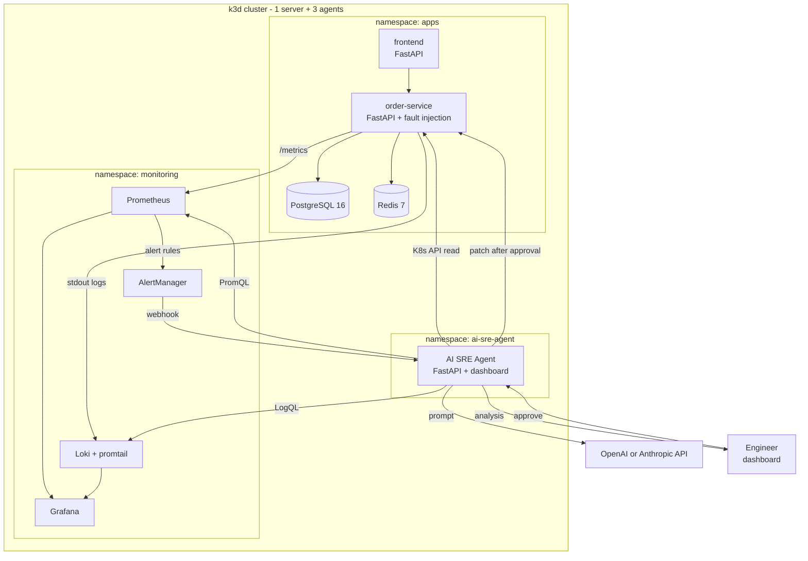
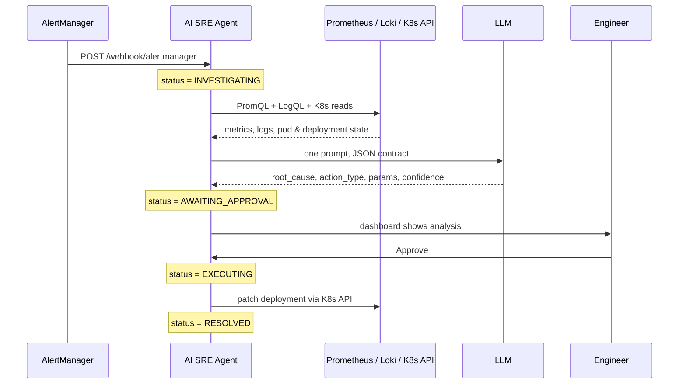

# AI SRE Agent — AI-Powered Incident Response on Kubernetes

A working proof of concept: an agent that receives real Kubernetes alerts, investigates
them using metrics, logs and cluster state, asks an LLM for a root-cause analysis, and
executes an approved remediation against the cluster.

Everything runs locally on a laptop. The whole loop — alert to fixed cluster — takes
about ten seconds of machine time plus however long you take to click Approve.

```
alert fires → agent gathers evidence → LLM analyses → you approve → cluster patched
```

**What makes it more than a chatbot:** the model never writes a command. It picks one of
five predefined actions and fills in parameters. A human approves before anything touches
the cluster, and RBAC bounds what the agent can do even if approval is given carelessly.

---

## Contents

- [Architecture](#architecture)
- [How the agent works](#how-the-agent-works)
- [Prerequisites](#prerequisites)
- [Setup](#setup)
- [Testing it](#testing-it)
- [Project structure](#project-structure)
- [Configuration](#configuration)
- [Credentials and secrets](#credentials-and-secrets)
- [Known limitations](#known-limitations)

---

## Architecture



| Namespace | Contents |
|---|---|
| `apps` | The workload being monitored — frontend, order-service, PostgreSQL, Redis |
| `monitoring` | Prometheus, Grafana, Loki, promtail, AlertManager |
| `ai-sre-agent` | The agent, its ServiceAccount and RBAC |
| `argocd` | ArgoCD (optional GitOps layer) |
| `ingress-nginx` | Ingress controller |

---

## How the agent works

### The incident lifecycle



### What it gathers

Before calling the LLM, the agent collects evidence from three sources in parallel:

**Prometheus** — four PromQL queries always, plus two more for HTTP/latency alerts:
```promql
kube_pod_container_status_restarts_total{namespace="apps"}
kube_pod_status_phase{namespace="apps"}
container_memory_working_set_bytes{namespace="apps", container!=""}
rate(container_cpu_usage_seconds_total{namespace="apps", container!=""}[5m])
```

**Loki** — error-level logs from the last 15 minutes:
```logql
{namespace="apps"} |~ "(?i)(error|exception|traceback)"
```

**Kubernetes API** — container states (including `last_terminated_reason`, which is how
OOMKills are detected), every pod with its restart count, the last 15 events, and each
deployment's replica counts and current image.

All three are stringified into a single prompt that asks for a fixed JSON response.

### What it can do

The model chooses one `action_type`. It cannot emit arbitrary commands:

| Action | Effect |
|---|---|
| `restart_pods` | Rolling restart via a pod-template annotation |
| `rollback_deployment` | Restores the pod template from the previous ReplicaSet revision |
| `scale_up` | Patches replica count |
| `adjust_resources` | Patches the container's resource requests and limits |
| `manual` | No automation — the analysis is advice only |

If an alert clears before you act on it, the agent closes the incident as
`AUTO_RESOLVED` rather than leaving an approval request for a problem that no longer
exists. That status is kept separate from `RESOLVED` so self-healing blips are never
counted as agent remediations.

Anything unrecognised is rejected and nothing happens.

### The safety model

Three independent bounds, so no single failure lets the agent do real damage:

1. **Fixed action vocabulary** — the model picks a verb from a list; it never writes shell or kubectl
2. **Human approval** — `analyze_incident()` stops at `AWAITING_APPROVAL` and returns. Nothing touches the cluster until you POST to `/api/incidents/{id}/approve`
3. **RBAC** — the ServiceAccount can *read* pods, logs, events, services, configmaps and namespaces, and can only *patch* deployments, replicasets and statefulsets. It cannot delete anything, read secrets, or create resources

---

## Prerequisites

| Tool | Notes |
|---|---|
| [OrbStack](https://orbstack.dev/) or Docker Desktop | Container runtime |
| [k3d](https://k3d.io/) | `brew install k3d` |
| kubectl | `brew install kubectl` |
| Helm 3 or 4 | `brew install helm` — both work |
| An LLM API key | OpenAI (default) **or** Anthropic |

Roughly 6 GB of free RAM for the cluster. Verified on Apple Silicon with k3d v5.9.0,
Kubernetes v1.35, and Helm v4.1.1.

---

## Setup

Five scripts, in order. Each is idempotent — safe to re-run.

### 0. Your API key

```bash
export OPENAI_API_KEY="sk-..."
```

Everything below must run in this same shell. To use Claude instead, export
`ANTHROPIC_API_KEY` and set `LLM_PROVIDER: "anthropic"` in
`k8s/ai-sre-agent/all.yaml`.

> Cost is negligible — an incident is a few thousand input tokens and well under a
> thousand out. A full run through every scenario costs cents.

### 1. Cluster

```bash
./scripts/setup-cluster.sh
```

Creates a k3d cluster (1 server + 3 agents) with a local registry on `localhost:5111`,
replaces Traefik with ingress-nginx, and publishes ingress on **18080/18443** — deliberately
clear of the 8080/8443 used by port-forwards later.

Verify: `kubectl get nodes` shows 4 nodes `Ready`.

### 2. Observability

```bash
./scripts/setup-observability.sh
```

Installs kube-prometheus-stack (Prometheus, Grafana, AlertManager), the custom alert
rules, then Loki and promtail. Takes 5–8 minutes.

Verify:
```bash
kubectl get pods -n monitoring          # all Running, loki-0 included
kubectl exec -n monitoring loki-0 -- wget -qO- \
  'http://kube-prometheus-stack-prometheus.monitoring:9090/api/v1/rules' \
  | grep -o '"name":"app\.[a-z.]*"'     # 4 custom rule groups
```

### 3. ArgoCD (optional)

```bash
export GIT_REPO_URL="https://github.com/<you>/ai-sre-poc.git"   # optional
./scripts/setup-argocd.sh
```

Without `GIT_REPO_URL` this installs ArgoCD but registers no Application — it will watch
nothing, which is fine if you only want the agent. Sync is deliberately **manual**: an
automated `selfHeal` policy would revert the chaos scenarios before an alert could fire.

### 4. Applications

```bash
./scripts/deploy-apps.sh
```

Builds and pushes the app images, deploys PostgreSQL, Redis, order-service and frontend.

Verify the metrics pipeline is live — this is the one most likely to be silently broken:
```bash
kubectl exec -n monitoring loki-0 -- wget -qO- \
  'http://kube-prometheus-stack-prometheus.monitoring:9090/api/v1/targets?state=active' \
  | python3 -c "
import sys,json
for t in json.load(sys.stdin)['data']['activeTargets']:
    if t['labels'].get('namespace')=='apps':
        print(' ', t['labels'].get('service'), t['health'])"
```
Expect `order-service up` (×2) and `frontend up`. An empty list means the ServiceMonitors
aren't matching and no HTTP alert can ever fire.

### 5. The agent

```bash
./scripts/deploy-ai-agent.sh
```

Verify the key actually reached the pod:
```bash
kubectl get secret ai-sre-agent-secret -n ai-sre-agent \
  -o jsonpath='{.data.OPENAI_API_KEY}' | base64 -d; echo
```

### 6. Open the dashboard

```bash
open http://ai-sre.localhost:18080
```

No port-forward needed — an Ingress routes through ingress-nginx, which the k3d
load balancer publishes on host port 18080. Browsers resolve `*.localhost` to
127.0.0.1 automatically, so there is no `/etc/hosts` entry to add.

> Prefer the Ingress over `kubectl port-forward` for anything you leave open. A
> port-forward is a single TCP tunnel bound to **one pod** — it dies when that pod
> is replaced, when the apiserver connection blips, or when the laptop sleeps.
> Approving a remediation frequently kills it, exactly when you want to watch.

Click **Trigger test alert** to run the full pipeline against a synthetic incident.

### Other UIs

| Service | Command | URL |
|---|---|---|
| **AI SRE Agent** | *(none — Ingress)* | **http://ai-sre.localhost:18080** |
| Grafana | `kubectl port-forward -n monitoring svc/kube-prometheus-stack-grafana 3000:80` | http://localhost:3000 (admin/admin) |
| Prometheus | `kubectl port-forward -n monitoring svc/kube-prometheus-stack-prometheus 9090:9090` | http://localhost:9090 |
| AlertManager | `kubectl port-forward -n monitoring svc/kube-prometheus-stack-alertmanager 9093:9093` | http://localhost:9093 |
| ArgoCD | `kubectl port-forward -n argocd svc/argocd-server 8443:443` | https://localhost:8443 |
| Frontend | `kubectl port-forward -n apps svc/frontend 3001:3000` | http://localhost:3001 |

---

## Testing it

Four chaos scenarios break the application in different ways so you can watch the agent
diagnose and repair each one.

**→ See [TESTING.md](TESTING.md) for the full walkthrough**, including what each scenario
actually produces, how to verify the remediation really happened, and how to tell a real
fix from a convincing log message.

Quick version:

```bash
./scripts/chaos/inject-crashloop.sh   # bad image tag
./scripts/chaos/inject-oom.sh         # memory limit too low
./scripts/chaos/inject-latency.sh     # 3s added to every request
./scripts/chaos/break-db.sh           # simulated DB outage
./scripts/chaos/reset.sh              # back to healthy
```

---

## Project structure

```
ai-sre-poc/
├── apps/
│   ├── ai-sre-agent/agent.py      # the agent: webhook, investigation, dashboard, remediation
│   ├── order-service/main.py      # FastAPI + fault-injection endpoints
│   └── frontend/main.py           # proxy UI for the order service
├── k8s/
│   ├── namespaces.yaml
│   ├── apps/all.yaml              # PostgreSQL, Redis, order-service, frontend, ServiceMonitors
│   ├── ai-sre-agent/all.yaml      # RBAC, ConfigMap, Deployment, Service
│   ├── alerting/prometheus-rules.yaml  # 9 custom alert rules
│   └── argocd/application.yaml    # GitOps Application (set repoURL)
├── helm-values/                   # chart overrides for Prometheus, Loki, ArgoCD
├── scripts/
│   ├── setup-*.sh                 # cluster, observability, argocd
│   ├── deploy-*.sh                # apps, agent
│   └── chaos/                     # fault injection + reset
├── .github/workflows/             # CI: lint + build
├── README.md                      # this file
├── TESTING.md                     # verification walkthrough
└── CLAUDE.md                      # detailed internal spec
```

---

## Configuration

### AI SRE Agent

Set in `k8s/ai-sre-agent/all.yaml` (ConfigMap) or via the Secret.

| Variable | Default | Notes |
|---|---|---|
| `LLM_PROVIDER` | `openai` | `openai` or `anthropic` |
| `OPENAI_API_KEY` | — | Required when provider is `openai` |
| `OPENAI_MODEL` | `gpt-5.5` | |
| `ANTHROPIC_API_KEY` | — | Required when provider is `anthropic` |
| `CLAUDE_MODEL` | `claude-opus-5` | |
| `PROMETHEUS_URL` | `http://kube-prometheus-stack-prometheus.monitoring:9090` | |
| `LOKI_URL` | `http://loki.monitoring:3100` | |
| `WATCH_NAMESPACE` | `apps` | Namespace the agent investigates |
| `SLACK_WEBHOOK_URL` | — | Optional notifications |

Both SDKs ship in the image, so switching providers is a ConfigMap edit plus a restart —
no rebuild.

### Order Service

| Variable | Default |
|---|---|
| `DB_HOST` | `postgres.apps.svc.cluster.local` |
| `DB_NAME` / `DB_USER` | `orders` |
| `REDIS_URL` | `redis://redis.apps.svc.cluster.local:6379` |

---

## Credentials and secrets

**The LLM API key is the only real credential in this project, and it is never committed.**

It lives in your shell, and `deploy-ai-agent.sh` creates a Kubernetes Secret from it at
deploy time. `k8s/ai-sre-agent/all.yaml` deliberately contains **no Secret object** — an
earlier version had one with a `PLACEHOLDER` value, which meant every `kubectl apply`
silently overwrote the real key with the placeholder. The `secretRef` is marked
`optional: true` so the agent still starts without it and reports "no API key" rather than
crash-looping.

### What *is* committed, on purpose

| Value | Where | Why it is safe |
|---|---|---|
| `POSTGRES_PASSWORD: orders-secret` | `k8s/apps/all.yaml` | In-cluster PostgreSQL on a throwaway k3d cluster, using `emptyDir` storage. Reachable only from inside the cluster; holds nothing but demo orders. |
| `DB_PASSWORD` default `orders-secret` | `apps/order-service/main.py` | Must match the above so the stack runs with no setup. |
| `adminPassword: admin` | `helm-values/kube-prometheus-stack-values.yaml` | Grafana on a local cluster, documented as `admin/admin` in the access table. |

These are demo credentials for a disposable local environment — the same convention as
`postgres:postgres` in a docker-compose example. They grant access to nothing that exists
outside your laptop, and hiding them would make the project harder to run without
protecting anything.

### What would change for a real deployment

- Application secrets from **External Secrets Operator**, **Sealed Secrets**, or a cloud
  secret manager (AWS Secrets Manager, GCP Secret Manager, Vault) — never from a manifest
- Workload identity for the LLM provider instead of a long-lived API key
- Per-environment credentials, rotated on a schedule
- Secret scanning in CI (`gitleaks`, `trufflehog`) so this stays true as the repo grows

The structural decision that matters is already in place: **the one credential with real
value is injected at deploy time and never enters git.**

---

## Known limitations

Deliberately honest, because the gap between the architecture diagram and the code is
usually where the interesting conversation is.

**Incidents are in-memory.** A dict in the agent process. Restart the pod and the history
is gone. This is also why the deployment is pinned to `replicas: 1` — two replicas would
each hold half the incidents and double-investigate every alert.

**No verification step.** After a remediation the status goes to `RESOLVED` based purely on
whether the K8s patch call threw an exception. Nothing re-checks that the alert actually
cleared. A patch that applies cleanly but doesn't fix the problem still reports success.

**No image-pull alert rule.** None of the nine custom rules detects `ImagePullBackOff`
directly. The crash-loop scenario is caught indirectly by `PodNotReady` after two minutes.

**Single namespace.** `WATCH_NAMESPACE` is one string. The agent investigates `apps` and
nothing else, though its RBAC is cluster-wide.

**Storage is ephemeral.** PostgreSQL and Loki both use `emptyDir`. Everything is lost when
a pod moves.

**The deprecated Loki chart.** `grafana/loki-stack` is archived upstream and pins an image
three years older than the config format it accepts. It works here with an explicit image
pin; migrating to the current `grafana/loki` chart is the real fix.

### What I'd build next

1. Persist incidents (PostgreSQL) so history survives restarts and the agent can scale out
2. A verification loop — re-query the alert after remediation and only then mark `RESOLVED`,
   with automatic rollback if it did not clear
3. An `ImagePullBackOff` alert rule, so a completely broken deployment is caught in seconds
   rather than minutes
4. Slack interactive approval, so you do not need the dashboard open
5. Confidence-gated auto-remediation — execute without approval only for `low` risk and
   `high` confidence, and only for reversible actions
