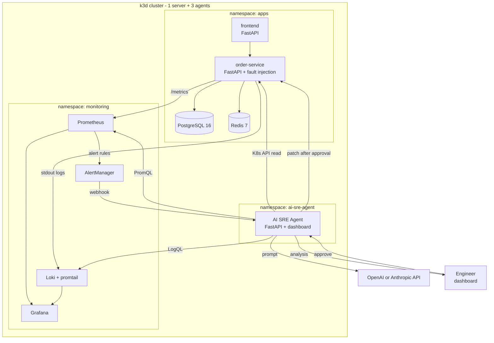
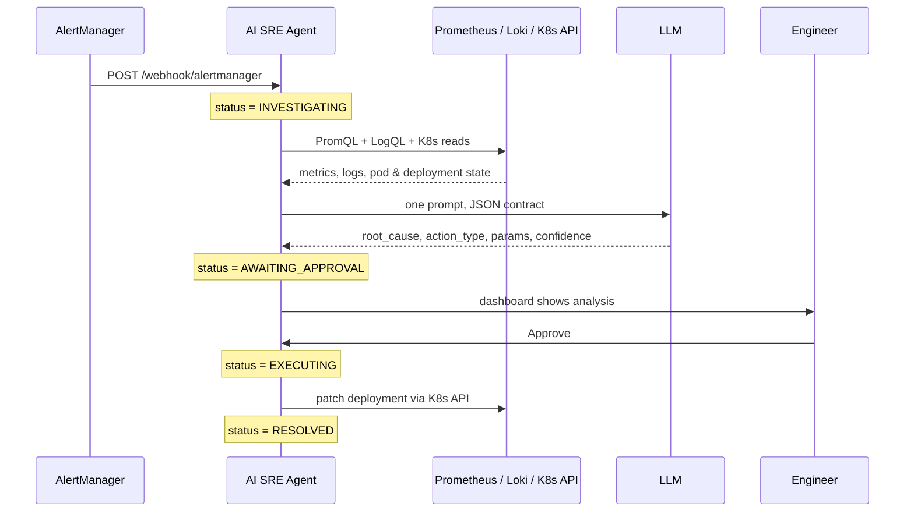

# AI SRE Agent — AI-Powered Incident Response on Kubernetes

An agent that receives real Kubernetes alerts, investigates them using metrics, logs and
cluster state, asks an LLM for a root-cause analysis, and executes an approved remediation
against the cluster.

```
alert fires → agent gathers evidence → LLM analyses → you approve → cluster patched
```

Everything runs locally on a laptop. Alert to fixed cluster takes about ten seconds of
machine time, plus however long you take to review.

---

## What this does, and what it doesn't

> The agent removes the **evidence-gathering** phase of incident response. For incidents
> matching known patterns it also proposes a specific, bounded remediation the engineer can
> execute with one click. The engineer still owns the decision — the system is built so that
> reviewing is fast and acting is safe, not so that the human can be skipped.

Being precise about that boundary matters, because it is where the design decisions come
from:

| It does | It doesn't |
|---|---|
| Gather metrics, logs and cluster state automatically | Replace the engineer's judgement |
| Produce a root cause in ~10s instead of minutes of tool-switching | Handle novel incidents outside its evidence queries |
| Reason across service boundaries — it traced an app outage to a scaled-down database | Act without approval |
| Recognise when *not* to act: stale alerts, monitoring meta-alerts | Always find an automated fix — roughly half of incidents end in `manual` |

The risk this design guards against is **automation complacency**. The time saving comes
from not *gathering* evidence; it does not come from not *reading* the analysis. That is
why the approval gate shows the exact parameters it will patch, and why an alert that
cleared by itself is recorded as `AUTO_RESOLVED` rather than counted as a fix.

---

## Architecture



---

## How it works



The **"AI" is a single API call.** Everything else is evidence gathering and guardrails —
which is where the engineering lives.

### The five actions

The model picks one `action_type` and fills in its parameters. It **cannot emit arbitrary
commands**:

| Action | Effect |
|---|---|
| `restart_pods` | Rolling restart via a pod-template annotation |
| `rollback_deployment` | Restores the pod template from the previous ReplicaSet revision |
| `scale_up` | Patches replica count |
| `adjust_resources` | Patches the container's CPU/memory requests and limits |
| `manual` | No automation — the analysis is advice only |

Anything unrecognised is rejected and nothing happens.

### Three safety bounds

1. **Fixed action vocabulary** — the model picks a verb from a list; it never writes shell
   or `kubectl`
2. **Human approval** — nothing touches the cluster until a signed-in engineer approves in
   a dialog that shows the exact parameters that will be patched; the timeline records who
   approved. AlertManager authenticates to the webhook with its own bearer token
3. **RBAC** — the ServiceAccount can *read* pods, logs, events, services and replicasets,
   and its only write is *patch* on deployments. It cannot delete anything, read secrets,
   create resources, or replace an object wholesale (`update`)

Implementation detail is in **[CLAUDE.md](CLAUDE.md)**.

---

## Quick start

**Prerequisites:** [OrbStack](https://orbstack.dev/) or Docker Desktop, [k3d](https://k3d.io/),
kubectl, Helm 3 or 4, and an OpenAI **or** Anthropic API key. Around 6 GB of free RAM.

```bash
export OPENAI_API_KEY="sk-..."      # same shell for every step below

./scripts/setup-cluster.sh          # k3d cluster + registry + ingress-nginx
./scripts/setup-observability.sh    # Prometheus, Grafana, AlertManager, alert rules, Loki
./scripts/setup-argocd.sh           # ArgoCD (set GIT_REPO_URL to register the Application)
./scripts/deploy-apps.sh            # PostgreSQL, Redis, order-service, frontend
./scripts/deploy-ai-agent.sh        # the agent
```

Each script is idempotent. Step 2 is the slow one (5–8 minutes).

To use Claude instead of OpenAI, export `ANTHROPIC_API_KEY` and set
`LLM_PROVIDER: "anthropic"` in `k8s/ai-sre-agent/all.yaml`. Both SDKs ship in the image.

Then sign in to the dashboard (password below) and click **Trigger test alert**. The
dashboard keeps 7 days of incidents, filters by time range, searches names, analysis and
the logs the agent collected, and lets you minimise or maximise each incident.

### Access

Everything is served by ingress-nginx on host port **18080** — no port-forwards. Browsers
resolve `*.localhost` to 127.0.0.1, so there is nothing to add to `/etc/hosts`.

| Service | URL | Credentials |
|---|---|---|
| **AI SRE Agent** | http://ai-sre.localhost:18080 | admin / below |
| **Order app** | http://orders.localhost:18080 | — |
| **Grafana** | http://grafana.localhost:18080 | admin / admin |
| **Prometheus** | http://prometheus.localhost:18080 | — |
| **AlertManager** | http://alertmanager.localhost:18080 | — |
| **ArgoCD** | http://argocd.localhost:18080 | admin / below |

The AI SRE dashboard password is generated on the first deploy and kept on redeploys
(export `DASHBOARD_PASSWORD` before deploying to choose your own):

```bash
kubectl -n ai-sre-agent get secret ai-sre-agent-secret \
  -o jsonpath='{.data.DASHBOARD_PASSWORD}' | base64 -d; echo
```

ArgoCD's admin password:

```bash
kubectl -n argocd get secret argocd-initial-admin-secret \
  -o jsonpath='{.data.password}' | base64 -d; echo
```

> **Don't omit the `:18080`.** The k3d load balancer publishes there rather than on port
> 80, leaving 8080/8443 free for port-forwards. Without the port you get "connection
> refused", which looks like a cluster problem but isn't.

---

## Testing it

Four chaos scenarios break the application in different ways so you can watch the agent
diagnose and repair each one.

```bash
./scripts/chaos/inject-crashloop.sh   # bad image tag
./scripts/chaos/inject-oom.sh         # memory limit too low
./scripts/chaos/inject-latency.sh     # 3s added to every request
./scripts/chaos/break-db.sh           # simulated DB outage
./scripts/chaos/reset.sh              # back to healthy
```

**→ [TESTING.md](TESTING.md)** has the full walkthrough: what each scenario actually
produces (several differ from what the names suggest), how to verify a remediation really
happened, and a troubleshooting section built from real failures.

---

## Project structure

```
apps/
  ai-sre-agent/agent.py    # webhook, investigation, dashboard, remediation
  order-service/main.py    # FastAPI + fault-injection endpoints
  frontend/main.py         # proxy UI
k8s/
  apps/  ai-sre-agent/     # workloads, RBAC, ServiceMonitors
  alerting/                # 9 custom alert rules
  ingress/  argocd/        # Ingress per namespace, GitOps Application
helm-values/               # Prometheus, Loki, ArgoCD chart overrides
scripts/                   # setup, deploy, chaos
README.md  TESTING.md  CLAUDE.md
```

---

## Credentials

**The LLM API key is the only real credential, and it is never committed.** It lives in
your shell; `deploy-ai-agent.sh` creates a Kubernetes Secret from it at deploy time.
`k8s/ai-sre-agent/all.yaml` deliberately contains **no Secret object** — an earlier version
had one with a placeholder value, which meant every `kubectl apply` silently overwrote the
real key.

The PostgreSQL password and Grafana's `admin/admin` **are** committed, on purpose: demo
values for a disposable local cluster, like `postgres:postgres` in a docker-compose
example. For anything real you would use External Secrets Operator, Sealed Secrets or a
cloud secret manager, plus secret scanning in CI.

---

## Known limitations

Deliberately honest — the gap between the diagram and the code is usually the interesting
conversation.

- **Single replica.** Incidents persist to SQLite on a volume and are kept for 7 days, but
  SQLite is single-writer, so the agent still runs as one replica.
- **No verification step.** After remediating, the status goes to `RESOLVED` based only on
  whether the K8s patch call threw. Nothing re-checks that the alert actually cleared.
- **One fault can raise several incidents.** `PodCrashLoopBackOff` and `PodNotReady` for
  the same pod each propose a rollback. Approve only one — a second rollback undoes the
  first.
- **The model under-uses `adjust_resources`.** In the OOM scenario it has recommended
  `manual`, and later `rollback_deployment`, but never raised the memory limit itself.
- **No ImagePullBackOff alert rule.** A completely broken deployment is caught only
  indirectly, by `PodNotReady`, after two minutes.
- **Single watched namespace**, and **ephemeral storage** — PostgreSQL and Loki both use
  `emptyDir`.

### What I'd build next

1. Move incidents to a shared database so the agent can scale out
2. A verification loop — re-check the alert after remediating, mark `FAILED` and roll back
   if it did not clear
3. Confidence-gated auto-remediation: skip approval only for low-risk, high-confidence,
   reversible actions

---

## Documentation

| File | Contents |
|---|---|
| **README.md** | This file — what it is, how it works, how to run it |
| **[TESTING.md](TESTING.md)** | Chaos scenarios, verification commands, troubleshooting |
| **[CLAUDE.md](CLAUDE.md)** | Implementation spec: internals, conventions, design rationale |
